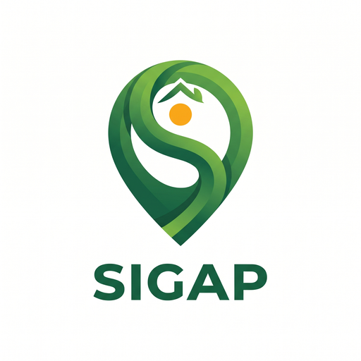

<div align="center">
  

  # SIGAP
  ### Sistem Informasi Geografis dan Aspirasi Publik

  [](https://laravel.com)
  [](https://php.net)
  [](https://tailwindcss.com)
  [](https://leafletjs.com)
  [](https://redis.io)
  [](LICENSE)

  <p>Platform digital desa terintegrasi untuk <strong>mengenali kondisi wilayah spasial</strong>, <strong>mengelola data kependudukan</strong>, dan <strong>melayani administrasi persuratan desa</strong> dalam satu sistem terpusat.</p>

  <p><em>Dikembangkan untuk ajang <strong>KRENOVA</strong> dengan pendekatan arsitektur bertahap, performa tinggi, ringan, dan mudah dikembangkan secara kolaboratif oleh tim kecil.</em></p>
</div>

---

## ✨ Fitur Utama

SIGAP mengintegrasikan tiga modul operasional inti:

| Modul | Fokus & Cakupan |
|---|---|
| 🗺️ **Pelaporan Masalah Wilayah (GIS)** | Penandaan titik lokasi koordinat, validasi batas poligon RT (GeoJSON), verifikasi Ketua RT, disposisi instruksi penanganan, dan validasi penyelesaian Kepala Desa |
| 👥 **Manajemen Kependudukan** | Pendataan warga, kartu keluarga, pembagian RT/RW, riwayat mutasi kependudukan, serta import/export data penduduk |
| 📄 **Pelayanan Surat Digital** | Pengajuan permohonan surat oleh warga, verifikasi pengantar RT berjenjang, penerbitan resmi oleh Kepala Desa, dan unduh dokumen PDF otomatis |

Didukung dengan modul pendukung:
- 📊 **Statistik & Visualisasi**: Dashboard grafik laporan masalah, demografi warga, dan agregasi layanan surat desa.
- 📢 **Informasi & Portal Publik**: Publikasi berita resmi, pengumuman agenda desa, dan potensi komoditas wilayah.
- 🔍 **Transparansi Aspirasi Publik**: Pemantauan progres penanganan aduan secara terbuka dan teranonimisasi demi privasi warga.
- 🔔 **Notifikasi Terpadu**: Notifikasi status aduan dan penerbitan surat secara langsung kepada warga.

---

## 👥 Role & Hak Akses Pengguna

Sistem menggunakan role-based access control (RBAC) via **Spatie Laravel Permission**:

| Role | Cakupan Hak Akses |
|---|---|
| **Publik (Guest)** | Mengakses portal informasi, peta wilayah desa, potensi desa, dan tracking laporan publik anonim |
| **Masyarakat** | Mengajukan laporan masalah, permohonan surat digital, melacak status pengajuan, dan mengelola profil mandiri |
| **Ketua RT** | Memvalidasi laporan masuk pada wilayah RT terkait, menangani aduan tingkat RT, menerbitkan surat pengantar RT, dan mengusulkan pembaruan data warga |
| **Kepala Desa** | Monitoring menyeluruh seluruh wilayah, memberikan disposisi instruksi penanganan, menandatangani/menerbitkan surat resmi, dan meninjau analitik desa |
| **Admin Sistem** | Pengelolaan master data wilayah/spasial (GeoJSON), manajemen akun & role, konfigurasi sistem, dan audit log |

---

## 🧱 Stack Teknologi

### Backend
- **Framework**: [Laravel 13](https://laravel.com)
- **Runtime**: PHP 8.3 / 8.4 / 8.5
- **Database**: MySQL 8+ / MariaDB / SQLite
- **Cache & Queue**: Redis via **Predis** driver
- **Otorisasi**: [Spatie Laravel-Permission](https://spatie.be/docs/laravel-permission)
- **Autentikasi Eksternal**: [Laravel Socialite](https://laravel.com/docs/socialite) (Google OAuth 2.0)
- **Ekspor Dokumen PDF**: [Barryvdh Laravel DomPDF](https://github.com/barryvdh/laravel-dompdf)
- **Pengolah Spreadsheet**: [Maatwebsite Excel 4.x](https://docs.laravel-excel.com)

### Frontend
- **Templating**: Blade Components
- **Styling**: [Tailwind CSS v4](https://tailwindcss.com) via Vite
- **Peta Digital & GIS**: [Leaflet.js](https://leafletjs.com) + OpenStreetMap tiles
- **Reaktivitas UI**: [Alpine.js](https://alpinejs.dev) untuk interaksi dinamis ringan

> 💡 **Arsitektur UI Bebas Overhead**: SIGAP **tidak menggunakan Filament atau admin framework berat** agar layout fleksibel, pemakaian memori server minimal, dan kontrol kode sepenuhnya berada di tangan pengembang.

---

## 📁 Struktur Direktori

```text
sigap-desa/
├── app/
│   ├── Enums/                 # StatusLaporan, StatusSurat, RoleEnum
│   ├── Http/
│   │   ├── Controllers/
│   │   │   ├── Admin/         # Manajemen wilayah, akun, master data
│   │   │   ├── Kades/         # Instruksi laporan, approval surat
│   │   │   ├── Masyarakat/    # Buat laporan, request surat, profil
│   │   │   ├── Public/        # Beranda publik, peta, portal berita
│   │   │   └── Rt/            # Verifikasi aduan wilayah, pengantar RT
│   │   ├── Middleware/        # Cek role, status akun
│   │   └── Requests/          # Form request validation
│   ├── Models/                # User, Penduduk, Keluarga, Laporan, Surat, WilayahRt
│   ├── Policies/              # Otorisasi per role dan per wilayah
│   ├── Services/              # Logika GIS spasial, generator surat, statistik
│   └── Jobs/                  # Queue jobs (notifikasi email, pembuatan PDF)
├── config/                    # dompdf.php, excel.php, permission.php, services.php
├── database/
│   ├── migrations/            # Skema database & tabel role
│   ├── seeders/               # RoleSeeder, WilayahSeeder, UserSeeder
│   └── factories/
├── resources/
│   ├── css/app.css            # Tailwind CSS source
│   ├── js/                    # Leaflet map picker, Alpine.js binding
│   └── views/
│       ├── components/        # Blade UI reusable components
│       ├── layouts/           # Template dasar
│       ├── public/            # Halaman portal umum
│       ├── masyarakat/        # Panel warga
│       ├── rt/                # Panel ketua RT
│       ├── kades/             # Panel monitoring kades
│       └── admin/             # Panel administrator
├── routes/
│   ├── web.php                # Rute aplikasi & portal
│   └── auth.php               # Rute autentikasi lokal & Google OAuth
├── tests/
│   ├── Feature/               # Uji alur laporan, surat, dan Google auth
│   └── Unit/
├── .env.example
├── composer.json
├── package.json
└── README.md
```

---

## 🚀 Panduan Instalasi & Menjalankan

### Prasyarat Sistem
- **PHP** >= 8.3 (direkomendasikan PHP 8.4 atau 8.5) dengan ekstensi `pdo`, `mbstring`, `openssl`, `gd`/`imagick`, `zip`, `fileinfo`.
- **Composer** >= 2.x
- **Node.js** >= 20.x & **NPM**
- **MySQL / MariaDB** (atau SQLite untuk uji coba lokal)
- **Redis Server** (opsional pada tahap development, direkomendasikan untuk production)

### Langkah-langkah

1. **Clone Repositori**:
   ```bash
   git clone https://github.com/uroo-dev/sigap-desa-krenova.git
   cd sigap-desa-krenova
   ```

2. **Pasang Dependensi Backend**:
   ```bash
   composer install
   ```

3. **Konfigurasi Environment**:
   ```bash
   cp .env.example .env
   php artisan key:generate
   ```
   Sesuaikan parameter database dan Redis pada `.env`:
   ```env
   DB_CONNECTION=mysql
   DB_HOST=127.0.0.1
   DB_PORT=3306
   DB_DATABASE=sigap_db
   DB_USERNAME=root
   DB_PASSWORD=

   REDIS_CLIENT=predis
   REDIS_HOST=127.0.0.1
   REDIS_PORT=6379
   ```

4. **Jalankan Migrasi & Seeder Awal**:
   ```bash
   php artisan migrate --seed
   ```

5. **Pasang Dependensi Frontend & Build Aset**:
   ```bash
   npm install
   npm run build
   ```

6. **Jalankan Server Development**:
   ```bash
   # Opsi 1: Menjalankan dev runner terintegrasi
   composer run dev

   # Opsi 2: Manual terpisah
   php artisan serve
   npm run dev
   php artisan queue:work
   ```
   Aplikasi dapat diakses melalui peramban di: `http://localhost:8000`

---

## 🔑 Konfigurasi Google OAuth (Socialite)

1. Buka [Google Cloud Console](https://console.cloud.google.com/).
2. Buat proyek baru dan navigasikan ke **APIs & Services** > **Credentials**.
3. Konfigurasikan **OAuth Consent Screen** (User Type: External).
4. Buat **OAuth 2.0 Client ID** bertipe *Web Application*.
5. Tambahkan pada **Authorized redirect URIs**:
   ```text
   http://localhost:8000/auth/google/callback
   ```
6. Salin nilai kredensial ke dalam file `.env`:
   ```env
   GOOGLE_CLIENT_ID=your-google-client-id.apps.googleusercontent.com
   GOOGLE_CLIENT_SECRET=your-google-client-secret
   GOOGLE_REDIRECT_URI="${APP_URL}/auth/google/callback"
   ```

---

## 🗺️ Integrasi Peta & Pemetaan Spasial (GIS)

- **Tile Provider**: OpenStreetMap (OSM) via Leaflet.js (tanpa kebutuhan API token berbayar).
- **Titik Koordinat Aduan**: Saat warga melapor, titik koordinat (`latitude`, `longitude`) dapat dipilih langsung pada peta interaktif atau memanfaatkan sensor GPS perangkat.
- **Batas Wilayah Poligon**: Batas wilayah desa dan RT disimpan dalam format **GeoJSON**.
- **Validasi Spasial**: Titik laporan diverifikasi berada di dalam batas poligon RT menggunakan perhitungan geometris titik-dalam-poligon (point-in-polygon).
- **Pembuatan Data Wilayah**: Anda dapat memetakan batas desa/RT melalui [geojson.io](https://geojson.io), mengunduh file `.geojson`, lalu mengimpornya pada panel Admin SIGAP.

---

## 🔐 Keamanan & Perlindungan Privasi Data

- **Enkripsi Data Sensitif**: Kolom identitas kependudukan privat (seperti NIK dan Nomor KK) dilindungi menggunakan fitur Eloquent Attribute Encryption (`encrypted`).
- **Isolasi Wilayah (Multi-tenancy per RT)**: Kebijakan akses (*Laravel Policy*) menjamin Ketua RT hanya memiliki otorisasi melihat dan memproses laporan di wilayahnya sendiri.
- **Anonimitas Aspirasi Terbuka**: Pada beranda publik, nama lengkap pelapor disamarkan secara otomatis untuk mencegah intimidasi dan menjaga kerahasiaan warga.
- **Anti-Tampering Dokumen**: Setiap surat digital yang diterbitkan dilengkapi kode verifikasi unik / QR-code validasi keaslian berkas.

---

## 🧪 Kualitas Kode & Pengujian

Sebelum melakukan commit atau membuat Pull Request, pastikan kode lulus verifikasi:

```bash
# Menjalankan seluruh test suite
php artisan test

# Format standar kode PHP sesuai standar PSR-12
./vendor/bin/pint

# Pengecekan tanpa mengubah file
./vendor/bin/pint --test
```

---

## 👥 Tim Pengembang (KRENOVA)

| Peran | Tanggung Jawab |
|---|---|
| **Lead Developer / GIS Specialist** | Arsitektur sistem, modul pelaporan masalah berbasis GIS, integrasi Leaflet spasial, dan validasi wilayah |
| **Backend & Data Engineer** | Modul kependudukan, alur surat digital berjenjang, generator PDF DomPDF, dan import/export Excel |
| **Frontend & UI/UX Engineer** | Desain antarmuka Blade + Tailwind CSS, responsivitas mobile, portal informasi publik, dan alur autentikasi |

---

## 🗓️ Roadmap Pengembangan

- [x] Inisialisasi arsitektur Laravel 13, Redis (Predis), Tailwind CSS
- [x] Sistem autentikasi ganda (Kredensial lokal & Google OAuth via Socialite)
- [x] Konfigurasi RBAC (Spatie Laravel Permission)
- [x] Generator surat digital PDF (DomPDF) & Ekspor/Impor data (Excel)
- [ ] Implementasi visual peta interaktif Leaflet & parsing batas GeoJSON
- [ ] Alur persetujuan surat berjenjang (Warga → RT → Kades)
- [ ] Modul penanganan aspirasi & disposisi instruksi tindak lanjut
- [ ] Fitur verifikasi keaslian surat via QR Code
- [ ] Integrasi Progressive Web App (PWA) untuk kemudahan akses warga dari ponsel pintar

---

## 🤝 Panduan Kontribusi

Kami sangat mengapresiasi kontribusi perbaikan dan pengembangan fitur. Silakan baca [CONTRIBUTING.md](CONTRIBUTING.md) untuk mempelajari standar penamaan branch, format Conventional Commits, dan alur Pull Request.

---

## 📜 Lisensi

Proyek ini dirilis di bawah lisensi terbuka [MIT License](LICENSE).

---

## 📬 Kontak & Informasi

- **Organisasi / Penyelenggara**: Tim SIGAP — KRENOVA
- **Surel Kontak**: [dimaseuro0706@gmail.com](mailto:dimaseuro0706@gmail.com)
- **Repositori Resmi**: [https://github.com/uroo-dev/sigap-desa-krenova](https://github.com/uroo-dev/sigap-desa-krenova)
